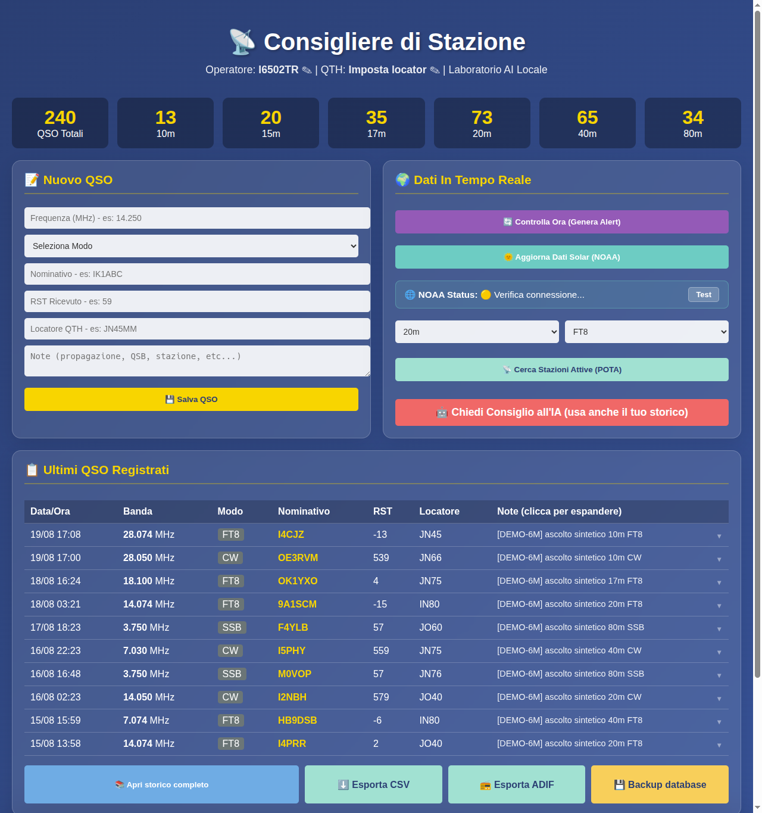

# Consigliere di Stazione 📡

[Italiano](README.md) · [English](README.en.md)

*Made in Italy by I6502TR*

Consigliere di Stazione is a local logbook and station advisor for amateur radio operators and shortwave listeners. Think of the experienced operator in the shack who checks the K-index, looks at what is active on the bands, and suggests where to listen first.

Your QSO log lives in a SQLite database on your computer. You can search and edit past contacts, export them as CSV or ADIF, and download a full database backup from the dashboard. The logbook works offline. Live solar data and Parks on the Air (POTA) spots need an internet connection. Neither service receives your log.



In builds with the **IT / EN** selector, choose **EN** at the top of the dashboard. The browser remembers your choice. Version 1.1.1 uses Italian labels, which are listed in the [English Quick Start](https://github.com/111blackeagle111/consigliere-di-stazione/wiki/Quick-Start).

## Get started

**Windows:** Download `ConsigliereDiStazione.exe` and its `.sha256` file from the [latest release](https://github.com/111blackeagle111/consigliere-di-stazione/releases/latest). Double-click the executable to open the dashboard at `http://localhost:8080`. The Windows build includes Python and the rule-based advisor.

**Linux and Raspberry Pi:** Set up a virtual environment and run the app from the source checkout. Python 3.12 is the version used in CI.

```bash
git clone https://github.com/111blackeagle111/consigliere-di-stazione.git
cd consigliere-di-stazione
python3 -m venv .venv
.venv/bin/python -m pip install -r requirements.txt
.venv/bin/python src/main.py
```

Open `http://localhost:8080` in your browser. The server listens on the local machine by default.

## The two advice buttons

- **Controlla Ora (Genera Alert)** checks current NOAA data and POTA activity across the bands. It can save a technical alert when conditions warrant one.
- **Chiedi Consiglio all'IA (usa anche il tuo storico)** uses the same live data and adds band and mode statistics from your entire manual QSO history. SQLite computes the totals locally. The advice appears on screen and stays out of the QSO log.

Both buttons fetch their own data. If you set your Maidenhead locator, the app can calculate the distance and bearing of POTA spots that include a locator.

Ollama and swlbot RAG are optional. In Italian, the app tries RAG first, then Qwen through Ollama, and finally its built-in rules. English advice starts with Qwen and falls back to the built-in rules because the current RAG service is Italian-only. The app checks generated advice for unsupported claims, including frequencies absent from the supplied data. If RAG or Ollama is configured on another machine, that endpoint may receive your locator, aggregate log statistics and the live data summary. Individual QSO records stay out of the prompt.

See the [English Wiki home](https://github.com/111blackeagle111/consigliere-di-stazione/wiki/English) for help getting started. The [contribution guide](CONTRIBUTING.md) explains how to report a bug or propose a change. Issues and pull requests in English are welcome.
